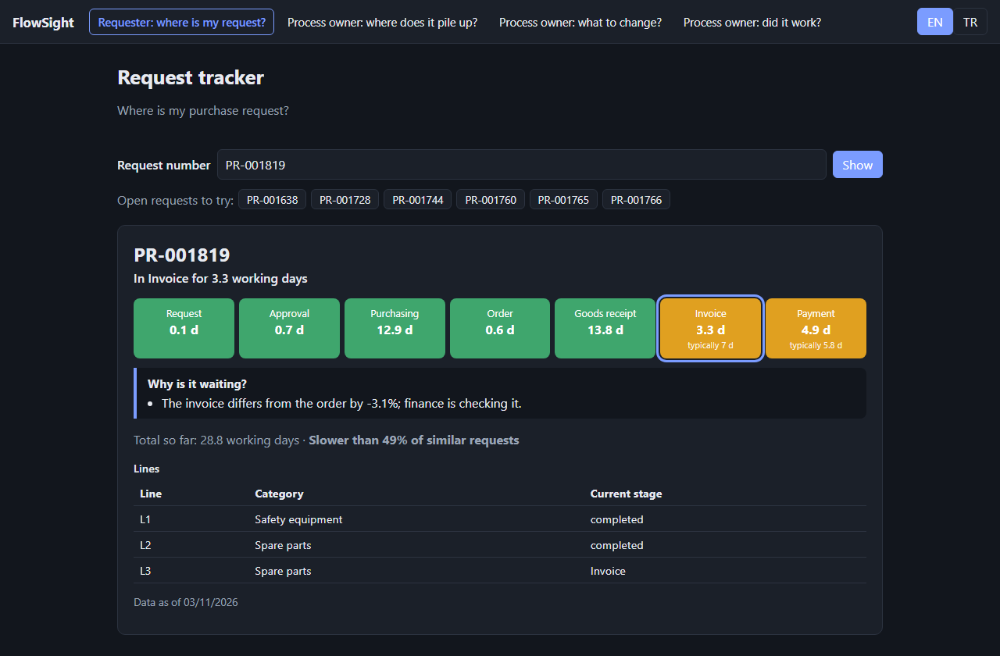
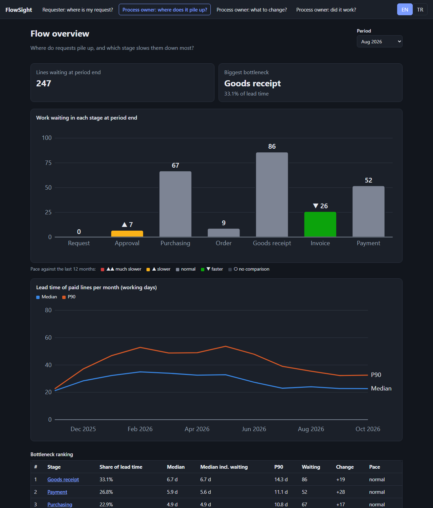
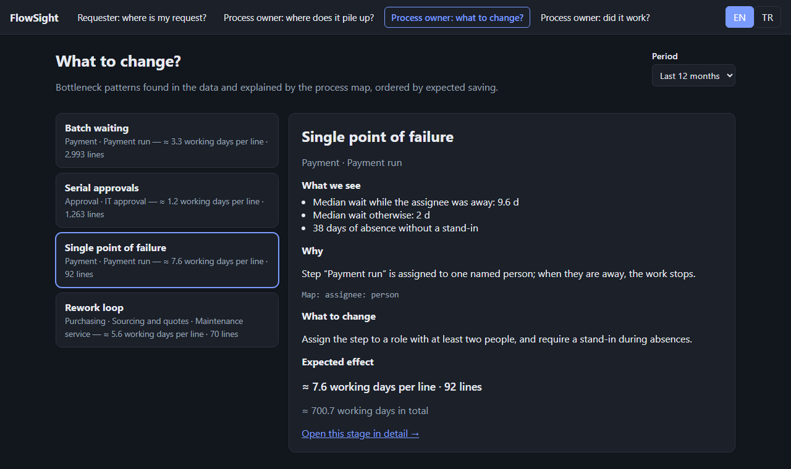
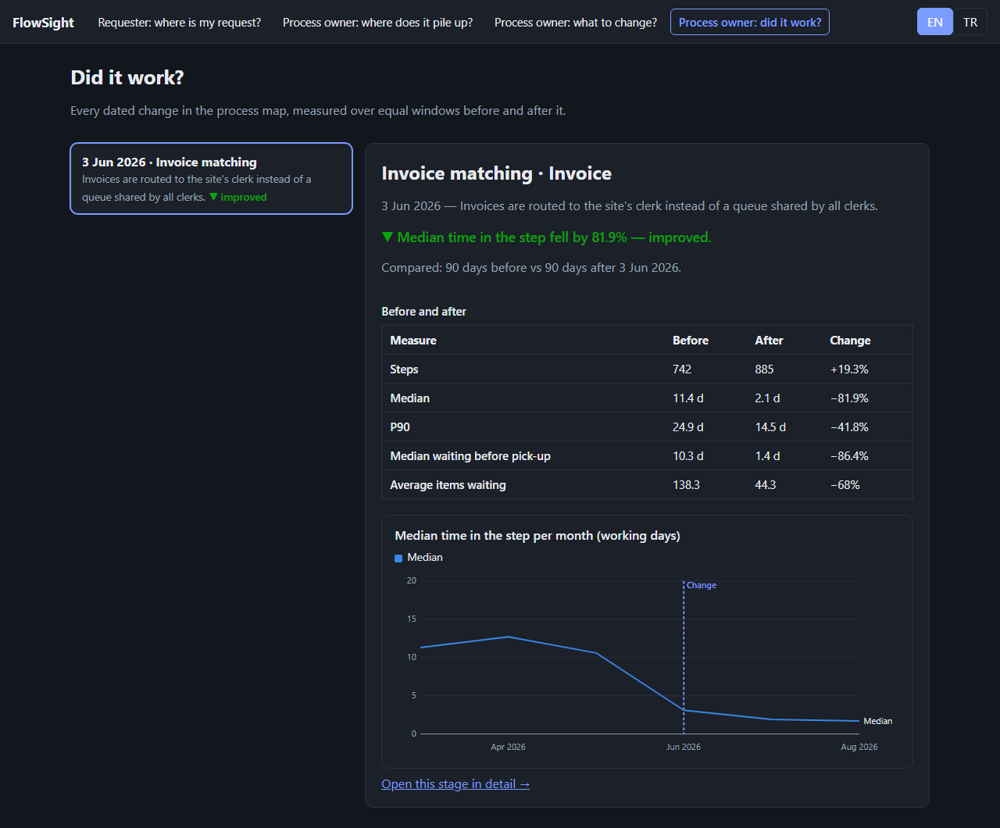

# FlowSight

FlowSight follows every purchase request from the moment it is opened until it is paid
(**Request → Approval → Purchasing → Order → Goods receipt → Invoice → Payment**), measures how long
each stage takes in working time, and shows where requests get stuck.

It serves two audiences:
- **Requesters and managers** see where their request is, how long it has been there and **why it is waiting** — without anyone's name.
- **Process owners and internal auditors** see where work piles up, which stages are slower than normal, and — per stage — waiting vs. working time, time per role and per person, and the slowest cases — plus **improvement cards**: bottleneck patterns found in the data, explained by the process map, with a proposed change and its expected saving — and, once a change is made, **whether it worked**.

The engine is a dependency-free .NET library, so it can run on synthetic data for this demo or be embedded in
a host application that reads real workflow and ERP history.

> **Status: v1.0.** All data in this repository is synthetic and generated from a fixed seed.
>
> **Live demo:** https://dogukanyllmaz.github.io/flowsight/

| Requester: where is my request? | Process owner: where does it pile up? |
|---|---|
|  |  |
| **Process owner: what to change?** | **Process owner: did it work?** |
|  |  |

## How FlowSight explains a bottleneck

Every finding needs two things: a **symptom in the data** and a **structure in the process map** that explains it.
FlowSight never guesses: each card lists the numbers it is based on and the map element it points at, and a pattern
whose input is missing is reported as *could not check* instead of being skipped silently.

| Pattern | Data symptom | Map structure | Proposed change |
|---|---|---|---|
| Shared queue | most of the step time is waiting; several people could pick each item | step assigned to a `group-queue` | route each item to the responsible person by a field |
| Serial approvals | a chain of approvals takes much longer than one approval | 3+ consecutive approval steps | parallel or amount-based approval |
| Single point of failure | waits explode while the assignee is away without a stand-in | step assigned to one `person` | assign to a role, require a stand-in |
| Rework loop | many items are sent back (often in one category) | a `return_to` edge | make the information mandatory at entry |
| Batch waiting | completions pile up on one weekday | weekly `schedule`, no SLA | daily processing with SLA and escalation |
| Exception queue | mismatched invoices take far longer than the rest | invoice matching step | tolerance rules, fix the price at order time |

The synthetic data contains one ground-truth scenario per pattern (for example, until month 8 invoices land in a
**queue shared by every accounts-payable clerk**; afterwards they are routed to the site's clerk). Tests check that each
pattern is found where it was injected and nowhere else. Open requests also carry plain-language **waiting reasons**
(assignee away, returned for correction, price variance, partial delivery, shared queue, weekly payment run).

### Closing the loop: did the change work?

When a process change is made, it is recorded in the map's `changes` list with its date and the values that applied
before. FlowSight then compares the changed step over **equal windows before and after** the date (up to 90 days each,
never crossing another change on the same step) and gives a rule-based verdict:

| Verdict | Rule (median time in the step, after ÷ before) |
|---|---|
| improved | ≤ 0.8 |
| worse | ≥ 1.2 |
| unchanged | in between |
| not enough data | fewer than 20 steps on either side, or a window shorter than 14 days |

In the demo data, routing invoices to the site's clerk (3 June 2026) cuts the median invoice time from about 11 working
days to about 2, and the average number of invoices waiting from about 140 to about 45. Improvement cards link to the
before/after of their step whenever a change has been recorded for it.

### Using your own process map

The map is YAML: [`samples/purchase-to-pay.yaml`](samples/purchase-to-pay.yaml). It is a superset of the
[process-mapping-toolkit](https://github.com/Dogukanyllmaz/process-mapping-toolkit) format and adds `stage`, the
assignee types `group-queue` and `field-routed`, `return_to`, `schedule: weekly:<day>` and dated `changes`
(with the values that applied *before* each change, so a past month is judged against the map as it was then).
Step `name` must equal the activity name in the event log.

## Run it

```bash
dotnet run --project src/FlowSight.Cli -- demo --out web/public/data
npm --prefix web install
npm --prefix web run dev
```

Open the printed local address. **Requester view:** pick an example request or type a number such as `PR-001783`.
**Process-owner view:** "where does it pile up?" shows the flow and each stage; "what to change?" shows the improvement cards; "did it work?" shows the before/after of each recorded change.
The interface is available in English and Turkish.

## Tests

```bash
dotnet test
npm --prefix web run test -- --run
```

Every push runs both test suites and the web build on GitHub Actions, plus a scan for sensitive terms whose list is
kept in a repository secret, never in the repository. A second workflow exports the demo data, builds the web app and
publishes it to GitHub Pages on every push to `main` (only while the repository is public).

## How it works

| Part | Responsibility |
|---|---|
| `src/FlowSight.Core` | Event model, working-time calendar (weekends, public and half-day holidays), line and request journeys, comparison with similar requests, period statistics (median, P90, Kaplan–Meier median incl. open items, WIP, ageing, share of lead time), bottleneck ranking, stage drill-down, process map (YAML), waiting reasons, pattern library and improvement cards, change impact (before/after), JSON contracts |
| `src/FlowSight.Synthetic` | Deterministic purchase-to-pay event log: invented sites, roles, categories and pseudonymous actors |
| `src/FlowSight.Cli` | `flowsight demo` writes the static JSON the web app reads: requester files and process-owner statistics |
| `web/` | React + TypeScript; screens read data through a swappable source (static JSON now, an HTTP API when embedded) |

Design and plans: [`docs/design`](docs/design) · [`docs/plans`](docs/plans).

## Roadmap

| Milestone | Delivers |
|---|---|
| **M1** ✅ | Request tracker on synthetic data |
| **M2** ✅ | Stage statistics, bottleneck ranking, flow overview, stage drill-down |
| **M3** ✅ | Waiting reasons, process map, bottleneck patterns and improvement cards |
| **M4** ✅ | Before / after measurement of process changes |
| **M5** ✅ | CI, live demo on GitHub Pages, v1.0 |

## License

MIT
